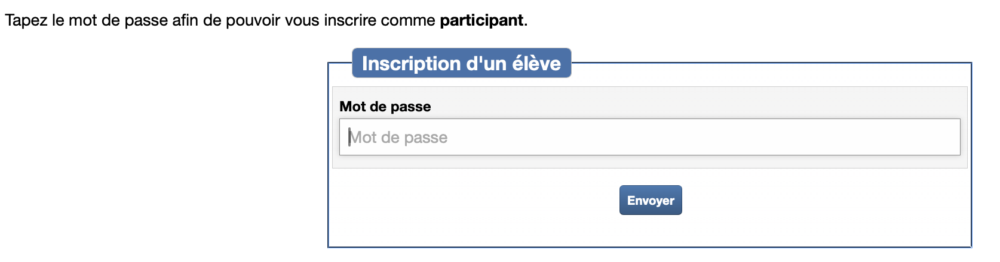
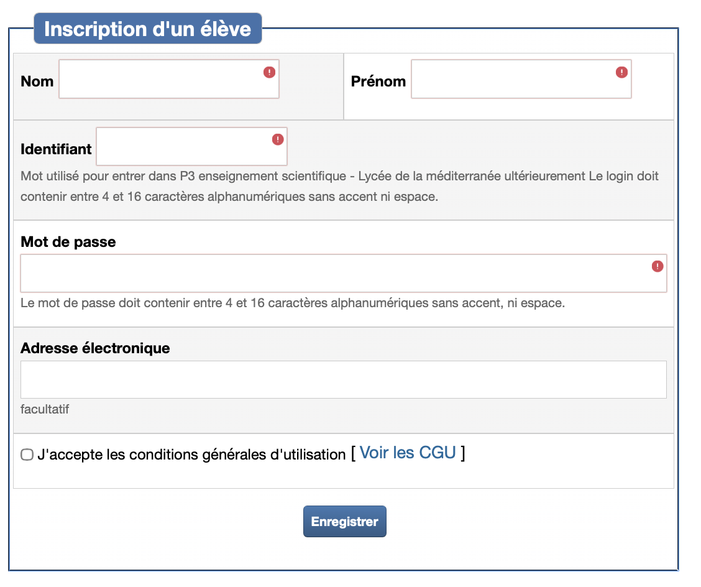

# Wims - Classe de premières

!!! info "Travail noté à faire sur Wims"
    - Wims propose des exercices à données aléatoires. Il permet de désactiver la prise en compte des notes le temps de maîtriser un exercice (n'oubliez pas de le faire c'est de votre responsabilité) puis d'activer la prise en compte des notes quand vous le souhaitez.
    - S'inscrire (une seule fois )sur le site [wims PNSI](https://wims.univ-cotedazur.fr/wims/wims.cgi?module=adm/class/classes&lang=fr&type=authparticipant&class=9874206&subclass=yes){:target="_blank"} en utilisant le code d'inscription "pnsimed"

## 🔗 Lien d'accès

- [Lien direct vers Wims PNSI](https://wims.univ-cotedazur.fr/wims/wims.cgi?module=adm/class/classes&lang=fr&type=authparticipant&class=9874206&subclass=yes){:target="_blank"}

## 👤 Création du compte

    

- 🔑 **Le code d'inscription** "pnsimed" est à saisir en bas de page et à n'utiliser qu'une fois par élève). Il vous permet d'accéder au formulaire d'inscription suivant :
    
    
    
    
    
    
- **Nom et prénom** : Attention à ne pas les inverser
- **Identifiant** : (respectez bien le format suivant)
    - Format : `prénom + 3 premières lettres du nom`
    - Exemple : Louis de Funès → `louisdef`
    - **Important** : Tout en minuscules sans accents ni espace
- 🔒 **Mot de passe**
    - Utilisez votre mot de passe **IACA** ou **Atrium** ainsi vous saurez toujours quoi mettre.
    - Évitez d'utiliser d'autres mots de passe, car même si je peux réinitialiser un mot de passe si vous l'avez oublié, cela vous coûtera des points.

## ⚠️ Recommandations importantes
- **Une seule inscription** : Ne créez qu'un seul compte. Tout compte supplémentaire sera automatiquement supprimé sans préavis. Seul le plus ancien sera conservé.
- **Problème technique** : 
    - Me contacter par la messagerie d'Atrium
    - Joindre une capture d'écran du problème
- **Gestion des notes** : 
    - Je ne peux pas supprimer de notes
    - Désactivez la notation pour vous entraîner (c'est de votre responsabilité)
    - Réactivez-la seulement quand vous maîtrisez l'exercice
    - Il y a un nombre minimum de répétitions à faire par exercice (par exemple si les points requis sont de 30, il faut faire l’exercice au minimun 3 fois car 3x10=30)
    - Les travaux seront considérés rendus en retard par rapport à la date que vous aura donnée votre professeur sur Pronote (les dates de fermetures de classe ou d'activités indiquées sur le site Wims ne vous concernent pas).
    

## 💡 Conseil pratique
Pour éviter le stress des notes pendant l'apprentissage, gardez la notation désactivée jusqu'à ce que vous soyez suffisamment à l'aise avec les exercices.
